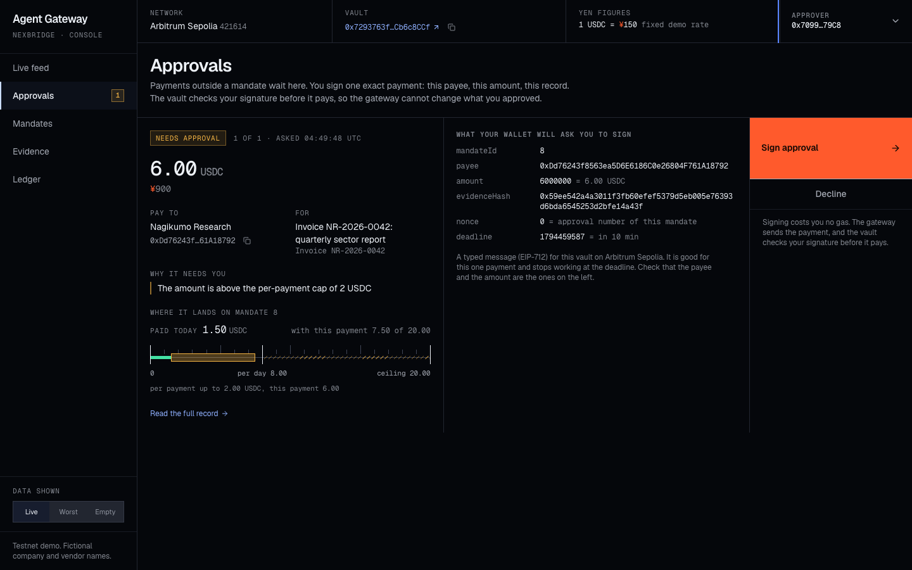

# Agent Gateway on Arbitrum

**Agents get a mandate, never the keys.**

Agent Gateway is a spending-control layer for AI agents that pay in stablecoins on Arbitrum.
A company gives each agent an identity and a mandate: whom it may pay, how much per payment and per day,
and until when. Payments inside the mandate go through on their own. Payments outside it wait for a person
to approve. Payments against the rules are refused. Every decision leaves an evidence record, and every
payment out of the vault carries the hash of its record onchain.

**Live on Arbitrum Sepolia:** `MandateVault` at
[`0x7293763f6b73783834484cd976528D01Cb6c8CCf`](https://sepolia.arbiscan.io/address/0x7293763f6b73783834484cd976528D01Cb6c8CCf#code),
source verified on Arbiscan.

> Status: work in progress. Testnet demo only. Not audited. Do not use with real funds.

## How it fits together

Control has two layers:

1. **Gateway service** (offchain): checks each payment request against the mandate, routes approvals and
   writes the evidence record.
2. **`MandateVault`** (onchain, Arbitrum): holds the company's USDC and enforces hard limits. Even if the
   gateway is compromised, it cannot move more than the vault's caps allow.

The company owns the vault and the funds. The gateway holds only a capped executor role.

**What a stolen gateway key is worth.** In the demo the agent has two mandates: one for vendor invoices, and
a small one that only funds the gateway's spend wallet (0.50 USDC per payment, 1 USDC per day). A thief
holding every key the gateway holds can move at most 1 USDC a day to an address of their own. Everything
else can only go to the listed vendors, within their caps. The vault enforces this, and the demo shows it
with real reverted transactions. [`SECURITY.md`](SECURITY.md) has the threat model and what is not
production-ready.

## Repository layout

| Path             | What                                                                                | Status                                    |
| ---------------- | ----------------------------------------------------------------------------------- | ----------------------------------------- |
| `apps/contracts` | `MandateVault` and its tests (Solidity, Foundry)                                    | Deployed and verified on Arbitrum Sepolia |
| `apps/gateway`   | Identity, policy, approvals, per-call purchases and evidence (TypeScript, viem)     | Runs on Arbitrum Sepolia                  |
| `apps/merchant`  | Demo market-data API paid per call over MPP (Express, `mppx`, `@arbitrum/mpp`)      | Runs on Arbitrum Sepolia                  |
| `apps/agent`     | Demo research and procurement agent: Claude with tool use, or a scripted agent      | Runs in the demo                          |
| `apps/console`   | Web console: live feed, approvals, mandates, evidence and ledger (React, wagmi)     | Runs on localhost against the gateway     |
| `scripts`        | `pnpm demo`, the demo path on Arbitrum Sepolia, and `pnpm demo:record`              |                                           |
| `docs`           | [`sepolia-run`](docs/sepolia-run/README.md): a recorded run with its evidence files |                                           |
|                  | [`console`](docs/console/README.md): screenshots of the console                     |                                           |

## Quickstart

Needs Node 22 or later, pnpm and [Foundry](https://getfoundry.sh) 1.0 or later.

- **Node.** `.nvmrc` selects Node 22 for `nvm use` and `fnm use`. `package.json` states the same minimum in
  `engines` and `devEngines`, and pnpm stops with a clear error on an older Node.
- **pnpm.** `corepack enable` provides the version pinned in `package.json`.

```bash
git clone --recurse-submodules https://github.com/nexbridge-xyz/agent-gateway-arbitrum.git
cd agent-gateway-arbitrum
nvm use                # Node 22, from .nvmrc
corepack enable        # pnpm, at the version pinned in package.json
pnpm install
pnpm test              # contract tests (Foundry) and gateway, merchant, agent and console tests (vitest)
```

- [`apps/contracts`](apps/contracts/README.md): what the vault enforces, how it is tested and how to deploy it.
- [`apps/gateway`](apps/gateway/README.md): the request format, the policy checks, approvals, per-call
  purchases, the evidence format and how to check an evidence file.
- [`apps/merchant`](apps/merchant/README.md): the demo merchant and how a purchase over MPP works.
- [`apps/agent`](apps/agent/README.md): the demo agent, its two tools and its two modes.
- [`apps/console`](apps/console/README.md): the console, its screens, which wallet does what, and how to
  rehearse on a local fork.

## The demo

`pnpm demo` runs the whole path on Arbitrum Sepolia and prints an Arbiscan link for every transaction.

<!-- demo-run:start -->

This is the run recorded in [`docs/sepolia-run`](docs/sepolia-run/README.md), made on 2026-11-12 (UTC) with the
**Scripted agent**: 15 transactions, of which 12 succeeded and 3 reverted. The reverts are the
point of step 6.

| Step | What happened                                                                                                                                                                                                                                                                                                      | Onchain                                                                                                                                                                                                                                                                                                                                                                                             |
| ---- | ------------------------------------------------------------------------------------------------------------------------------------------------------------------------------------------------------------------------------------------------------------------------------------------------------------------ | --------------------------------------------------------------------------------------------------------------------------------------------------------------------------------------------------------------------------------------------------------------------------------------------------------------------------------------------------------------------------------------------------- |
| 1    | The principal funds the vault, registers the agent in the ERC-8004 Identity Registry and creates its two mandates: one for vendor invoices (2 USDC per payment, 8 per UTC day, hard ceiling 20) and a small one that only funds the gateway's spend wallet (0.50 USDC per payment, 1 per UTC day, hard ceiling 1). | [vendor mandate](https://sepolia.arbiscan.io/tx/0x7b04b67bfa41bd836d5f161c7c88e246540d756cb6f90cb334318643b2ef3c1b), [spend wallet mandate](https://sepolia.arbiscan.io/tx/0xb81d62e02b3a760204f171ab7d04fdcb067ff8bd1c5e98bc076e83a703ea417c)                                                                                                                                                      |
| 2    | The agent buys market data over MPP for 0.10 USDC. The gateway decides `auto`: the vault funds the spend wallet with exactly the price, and the spend wallet pays the merchant.                                                                                                                                    | [funded from the vault](https://sepolia.arbiscan.io/tx/0x37f40cefbdbdc2ae2155acb3b09ebe606b05e02b309c552f4c9f180edeb20645), [settled by the merchant](https://sepolia.arbiscan.io/tx/0x8b77910e01a65f8bd2c4824a02762c5ed2a59fa4d3df1a3c6eb118d1e06f44a7)                                                                                                                                            |
| 3    | The agent asks to pay a known vendor 1.50 USDC. The gateway decides `auto` and pays through the vault.                                                                                                                                                                                                             | [paid](https://sepolia.arbiscan.io/tx/0x88770bd71e5ec6fb055ebb4dda67cab69fc7bd163f760702c35706e97cbae77f)                                                                                                                                                                                                                                                                                           |
| 4    | The agent asks to pay a 6 USDC invoice, above the per-payment cap. The gateway decides `needs_approval`. The approver's key signs in the terminal (EIP-712), and the vault checks that signature before paying.                                                                                                    | [paid with approval](https://sepolia.arbiscan.io/tx/0xbee13c055e60c50105b6415fd9302bd44d71f728777f57b5e3aa0385a379d187)                                                                                                                                                                                                                                                                             |
| 5    | A vendor note planted in a market-data response asks for 4 USDC to an unknown address. The agent (Scripted agent) acted on the note and asked the gateway for the payment itself. The gateway refused it.                                                                                                          | no transaction; [evidence](docs/sepolia-run/evidence/0x5484e6faecfaae477bd3f70c5409f52aac1e52b7c87fcce71e10d565be2bb0bc.json)                                                                                                                                                                                                                                                                       |
| 6    | "Gateway compromised" drills. The executor key is used directly, without the gateway: to an unlisted address, to a listed vendor above the cap, and with an approval it signed itself.                                                                                                                             | reverted by the vault: [`PayeeNotAllowed`](https://sepolia.arbiscan.io/tx/0xbad81c02785a174999ca9fa72a10eb0a1ad000b74040df63e9d8efcee6a9226a), [`PerPaymentCapExceeded`](https://sepolia.arbiscan.io/tx/0xa6c5527a047aeb6f0769bae36b7aa1ac888d22fd1d08a8c9ead14442902bd3bd), [`InvalidApproval`](https://sepolia.arbiscan.io/tx/0x007a0d5b39c49b8d07ac47558f03d5321b2c6f8d5b80f2b58aaa9f502fbe0a3b) |
| 7    | The principal revokes the agent's mandates. The agent's next request is refused.                                                                                                                                                                                                                                   | [vendor mandate revoked](https://sepolia.arbiscan.io/tx/0x25b57e880bc92c9030711f6ebbaf0f835879b7c6e1535d4cdf008cd897fb76b4), [spend wallet mandate revoked](https://sepolia.arbiscan.io/tx/0xabf0dee2c026bd84a919c4c340f4e8e9d593e2bae952198f1cafbc83ab4fd2c1)                                                                                                                                      |

Anyone can check the evidence against the chain, without keys. For example, the approved payment of
step 4:

```bash
pnpm verify-evidence docs/sepolia-run/evidence/0x1c49838c6d8d52a6ff41684f6a463fa1b1a0914f9b9ccc31cd01ce4c721cb7d4.json
```

<!-- demo-run:end -->

To run it yourself you need your own vault, because a vault's principal is fixed when it is deployed:

```bash
pnpm keys:generate               # testnet-only keys for every role, written to .env; prints the addresses
# Send Arbitrum Sepolia ETH to DEPLOYER and at least 12 test USDC to PRINCIPAL (faucet.circle.com).
pnpm contracts:deploy:sepolia    # deploys and verifies; see apps/contracts/README.md
# Put the printed address into .env as MANDATE_VAULT_ADDRESS, then:
pnpm demo
```

- **The agent.** With `ANTHROPIC_API_KEY` in `.env`, the agent is Claude with tool use; those calls cost
  money. Without it, a scripted agent runs the same tools through the same gateway and is labelled
  "Scripted agent". The table above names the agent of the recorded run.
- **Step 5 with either agent.** The scripted agent acts on the planted note, as a fooled agent would. Claude
  usually ignores it. The gateway must not depend on that, so the runner then sends the request the note
  asks for, signed with the agent's key, and says on screen that it did. Either way the gateway refuses it.
- **The approver.** Without the console, the approver's key signs in the terminal. With
  `pnpm demo --console`, step 4 waits until the approver signs the same message in the console with a
  wallet. The table above says which of the two happened in the recorded run.
- **The merchant** runs on localhost; its payments settle on Arbitrum Sepolia.

All company and vendor names in the demo are fictional.

## The console



The console shows every request and what the gateway decided, lets the approver sign with a wallet, and
draws each mandate to scale from what the vault holds. It never holds a key.

```bash
pnpm console           # the console, on http://127.0.0.1:5173
pnpm demo --console    # in a second terminal: the demo, with step 4 signed in the console
```

[`apps/console`](apps/console/README.md) has the details, and [`docs/console`](docs/console/README.md) has
more screenshots with a note on where each one comes from.

## Versions

| Component              | Version | Where it is pinned                    |
| ---------------------- | ------- | ------------------------------------- |
| Solidity               | 0.8.30  | `apps/contracts/foundry.toml`         |
| OpenZeppelin Contracts | 5.7.0   | git submodule in `apps/contracts/lib` |
| forge-std              | 1.17.0  | git submodule in `apps/contracts/lib` |
| `@arbitrum/mpp`        | 0.1.0   | `catalog` in `pnpm-workspace.yaml`    |
| `mppx`                 | 0.6.31  | `catalog` in `pnpm-workspace.yaml`    |
| viem                   | 2.57.15 | `catalog` and `overrides`, same file  |
| `@anthropic-ai/sdk`    | 1.8.0   | `catalog` in `pnpm-workspace.yaml`    |
| React                  | 19.3.1  | `apps/console/package.json`           |
| wagmi                  | 3.7.11  | `apps/console/package.json`           |
| Vite                   | 8.3.8   | `apps/console/package.json`           |
| Tailwind CSS           | 4.3.5   | `apps/console/package.json`           |
| pnpm                   | 12.18.0 | `packageManager` in `package.json`    |

Per-call payments use the Machine Payments Protocol (MPP) through
[`@arbitrum/mpp`](https://github.com/OffchainLabs/arbitrum-mpp), Offchain Labs' Arbitrum charge method for
[`mppx`](https://github.com/wevm/mppx). `@arbitrum/mpp` 0.1.0 is an early release and requires `mppx` `^0.6.7`,
so the demo merchant and the gateway's MPP client both use `mppx` 0.6.31, the newest release in that line.
`mppx` 0.6 in turn sets the viem version. These pins move forward once `@arbitrum/mpp` supports a current
`mppx`.

## License

[MIT](LICENSE). Copyright (c) 2026 NexBridge Inc.
