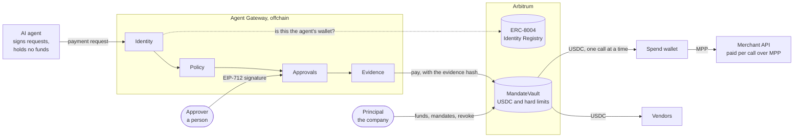

# Agent Gateway on Arbitrum

**Agents get a mandate, never the keys.**

Agent Gateway works like a corporate card program for AI agents, settled in USDC on Arbitrum. A company
gives each agent an identity and a mandate: whom it may pay, how much per payment and per day, and until
when. A vault contract on Arbitrum holds the money and enforces the limits.

- **Video, 2 minutes:** to be added with the final recorded run.
- **Live on Arbitrum Sepolia:** `MandateVault` at
  [`0x7293763f6b73783834484cd976528D01Cb6c8CCf`](https://sepolia.arbiscan.io/address/0x7293763f6b73783834484cd976528D01Cb6c8CCf#code),
  source verified on Arbiscan.
- **A recorded run:** [every transaction and evidence file of one run](docs/sepolia-run/README.md), each
  transaction with its Arbiscan link.

> Testnet demo. Not audited. Do not use with real funds.

## The problem

AI agents are starting to pay: for data, for API calls, for invoices. Today a company can give an agent a
key or a card that spends without limits, or have a person approve every single payment. Neither works for
a bank, a securities firm or a fintech that has to show who allowed a payment, and why.

## How it works



The agent never holds a key that can move money. It holds one key, and that key can only sign requests.

1. The agent sends a signed payment request to the gateway.
2. The gateway checks who is asking: the request must be signed by the wallet registered for that agent in
   the ERC-8004 Identity Registry. Then it checks the request against the agent's mandate. The checks are
   plain code. No model takes part in the decision.
3. Inside the mandate, the gateway pays through the vault at once. Outside it, the payment waits until a
   person, the approver, signs it with a wallet. Against the rules, it is refused and nothing is sent.
4. Every decision leaves an evidence record: who asked, what for, and how each check went. Every payment
   out of the vault carries the hash of its record onchain.

Control has two layers. The **gateway** decides. The **`MandateVault`** contract holds the company's USDC
and enforces the mandate's hard limits on every payment, whatever the gateway does. The company owns the
vault and the funds. The gateway holds only a capped executor role.

An API that charges per call is paid over MPP, the Machine Payments Protocol: the vault funds the gateway's
spend wallet with exactly the price of that call, and the spend wallet pays the merchant.

[`docs/ARCHITECTURE.md`](docs/ARCHITECTURE.md) follows one payment through every part.

## The demo

`pnpm demo` runs the whole path on Arbitrum Sepolia and prints an Arbiscan link for every transaction.

<!-- demo-run:start -->

This is the run recorded in [`docs/sepolia-run`](docs/sepolia-run/README.md), made on 2026-11-12 (UTC) with the
**Scripted agent**: 15 transactions, of which 12 succeeded and 3 reverted. The reverts are the
point of step 6.

| Step | What happened                                                                                                                                                                                                                                                                                                                                   | Onchain                                                                                                                                                                                                                                                                                                                                                                                             |
| ---- | ----------------------------------------------------------------------------------------------------------------------------------------------------------------------------------------------------------------------------------------------------------------------------------------------------------------------------------------------- | --------------------------------------------------------------------------------------------------------------------------------------------------------------------------------------------------------------------------------------------------------------------------------------------------------------------------------------------------------------------------------------------------- |
| 1    | The principal funds the vault and creates the agent's two mandates: one for vendor invoices (2 USDC per payment, 8 per UTC day, hard ceiling 20) and a small one that only funds the gateway's spend wallet (0.50 USDC per payment, 1 per UTC day, hard ceiling 1). The agent was registered in the ERC-8004 Identity Registry before this run. | [agent registered, earlier](https://sepolia.arbiscan.io/tx/0xc5bb229fa23bb579d29ff41975b0b103e551abc2c1999f3a9f2b94e8354f07e4), [vendor mandate](https://sepolia.arbiscan.io/tx/0x7b04b67bfa41bd836d5f161c7c88e246540d756cb6f90cb334318643b2ef3c1b), [spend wallet mandate](https://sepolia.arbiscan.io/tx/0xb81d62e02b3a760204f171ab7d04fdcb067ff8bd1c5e98bc076e83a703ea417c)                      |
| 2    | The agent buys market data over MPP for 0.10 USDC. The gateway decides `auto`: the vault funds the spend wallet with exactly the price, and the spend wallet pays the merchant.                                                                                                                                                                 | [funded from the vault](https://sepolia.arbiscan.io/tx/0x37f40cefbdbdc2ae2155acb3b09ebe606b05e02b309c552f4c9f180edeb20645), [settled by the merchant](https://sepolia.arbiscan.io/tx/0x8b77910e01a65f8bd2c4824a02762c5ed2a59fa4d3df1a3c6eb118d1e06f44a7)                                                                                                                                            |
| 3    | The agent asks to pay a known vendor 1.50 USDC. The gateway decides `auto` and pays through the vault.                                                                                                                                                                                                                                          | [paid](https://sepolia.arbiscan.io/tx/0x88770bd71e5ec6fb055ebb4dda67cab69fc7bd163f760702c35706e97cbae77f)                                                                                                                                                                                                                                                                                           |
| 4    | The agent asks to pay a 6 USDC invoice, above the per-payment cap. The gateway decides `needs_approval`. The approver's key signs in the terminal (EIP-712), and the vault checks that signature before paying.                                                                                                                                 | [paid with approval](https://sepolia.arbiscan.io/tx/0xbee13c055e60c50105b6415fd9302bd44d71f728777f57b5e3aa0385a379d187)                                                                                                                                                                                                                                                                             |
| 5    | A vendor note planted in a market-data response asks for 4 USDC to an unknown address. The agent (Scripted agent) acted on the note and asked the gateway for the payment itself. The gateway refused it.                                                                                                                                       | no transaction; [evidence](docs/sepolia-run/evidence/0x5484e6faecfaae477bd3f70c5409f52aac1e52b7c87fcce71e10d565be2bb0bc.json)                                                                                                                                                                                                                                                                       |
| 6    | "Gateway compromised" drills. The executor key is used directly, without the gateway: to an unlisted address, to a listed vendor above the cap, and with an approval it signed itself.                                                                                                                                                          | reverted by the vault: [`PayeeNotAllowed`](https://sepolia.arbiscan.io/tx/0xbad81c02785a174999ca9fa72a10eb0a1ad000b74040df63e9d8efcee6a9226a), [`PerPaymentCapExceeded`](https://sepolia.arbiscan.io/tx/0xa6c5527a047aeb6f0769bae36b7aa1ac888d22fd1d08a8c9ead14442902bd3bd), [`InvalidApproval`](https://sepolia.arbiscan.io/tx/0x007a0d5b39c49b8d07ac47558f03d5321b2c6f8d5b80f2b58aaa9f502fbe0a3b) |
| 7    | The principal revokes the agent's mandates. The agent's next request is refused.                                                                                                                                                                                                                                                                | [vendor mandate revoked](https://sepolia.arbiscan.io/tx/0x25b57e880bc92c9030711f6ebbaf0f835879b7c6e1535d4cdf008cd897fb76b4), [spend wallet mandate revoked](https://sepolia.arbiscan.io/tx/0xabf0dee2c026bd84a919c4c340f4e8e9d593e2bae952198f1cafbc83ab4fd2c1)                                                                                                                                      |

Anyone can check the evidence against the chain, without keys. For example, the approved payment of
step 4:

```bash
pnpm verify-evidence docs/sepolia-run/evidence/0x1c49838c6d8d52a6ff41684f6a463fa1b1a0914f9b9ccc31cd01ce4c721cb7d4.json
```

<!-- demo-run:end -->

- **The agent.** With `ANTHROPIC_API_KEY` in `.env`, the agent is Claude with tool use; those calls cost
  money. Without it, a scripted agent runs the same tools through the same gateway and is labelled
  "Scripted agent". The table above names the agent of the recorded run.
- **Step 5 with either agent.** The scripted agent acts on the planted note, as a fooled agent would. Claude
  usually ignores it. The gateway must not depend on that, so the runner then sends the request the note
  asks for, signed with the agent's key, and says on screen that it did. Either way the gateway refuses it.
- **The approver.** Without the console, the approver's key signs in the terminal. With
  `pnpm demo --console`, step 4 waits until the approver signs the same message in the console with a
  wallet. The table above says which of the two happened in the recorded run.
- **The merchant** runs on localhost; its payments settle on Arbitrum Sepolia.

All company and vendor names in the demo are fictional.

## The console


The console shows every request and what the gateway decided, lets the approver sign with a wallet, and
draws each mandate to scale from what the vault holds. It never holds a key.
[`apps/console`](apps/console/README.md) has the details, and [`docs/console`](docs/console/README.md) has
more screenshots with a note on where each one comes from.

## Why Arbitrum

- **Agent identity is already there.** The ERC-8004 Identity Registry is deployed on Arbitrum One and on
  Arbitrum Sepolia ([addresses](https://github.com/erc-8004/erc-8004-contracts)). The gateway accepts a
  request only from the wallet registered there for the agent. The demo's agent is number 354 in the
  Sepolia registry
  ([registration](https://sepolia.arbiscan.io/tx/0xc5bb229fa23bb579d29ff41975b0b103e551abc2c1999f3a9f2b94e8354f07e4)).
- **Machine payments are already there.** Offchain Labs' [`@arbitrum/mpp`](https://github.com/OffchainLabs/arbitrum-mpp)
  settles a per-call payment in USDC on Arbitrum One or Arbitrum Sepolia. The payer signs and pays no gas;
  the merchant submits the transfer
  ([docs](https://docs.arbitrum.io/arbitrum-essentials/machine-payments-protocol)). It is an early release,
  0.1.0, and the demo uses it as it is. Coinbase's x402 facilitator lists Arbitrum One too
  ([network support](https://docs.cdp.coinbase.com/x402/network-support)); that is on the roadmap.
- **The dollars are already there.** Circle issues USDC natively on Arbitrum
  ([addresses](https://developers.circle.com/stablecoins/usdc-contract-addresses)), and Paxos has issued
  USDG natively on Arbitrum One since October 2026
  ([Arbitrum blog](https://blog.arbitrum.io/usdg-is-live-on-arbitrum/)).
- **Blocks are fast and a payment is small.** The nominal block time on Arbitrum One is 250 ms
  ([docs](https://docs.arbitrum.io/how-arbitrum-works/timeboost/gentle-introduction)), so a paid API call
  does not wait long for its payment. The gas figures of the recorded run are below.
- **Regulated firms build on the same stack.** Robinhood Chain, Robinhood's chain for tokenized assets,
  launched its public mainnet in July 2026 and is built on the Arbitrum platform
  ([announcement](https://robinhood.com/newsroom/robinhood-accelerates-global-expansion-robinhood-chain-mainnet-stock-tokens-agentic-trading/)).
  Mandates for tokenized-asset orders there are on the roadmap.

<!-- demo-gas:start -->

In the recorded run a payment through the vault used about 127,000 gas, and the merchant's
settlement of a per-call purchase about 98,000. All 15 transactions together paid 0.000031 ETH in
fees on Arbitrum Sepolia. Testnet fees are not mainnet fees, but the gas is the same.

<!-- demo-gas:end -->

## Quickstart

Needs Node 22 or later and [Foundry](https://getfoundry.sh) 1.0 or later. `.nvmrc` selects the Node
version, and `corepack enable` provides the pnpm version pinned in `package.json`.

```bash
git clone --recurse-submodules https://github.com/nexbridge-xyz/agent-gateway-arbitrum.git
cd agent-gateway-arbitrum
nvm use
corepack enable
pnpm install
pnpm test
pnpm verify-evidence docs/sepolia-run/evidence/*.json
```

The last command needs no keys. It reads every evidence file of the recorded run, checks its hash and
signatures, and compares it with the vault's events on Arbitrum Sepolia.

To run the demo yourself you need your own vault, because a vault's principal is fixed when it is
deployed. Three more commands:

```bash
pnpm keys:generate               # testnet-only keys for every role, written to .env; prints the addresses
pnpm contracts:deploy:sepolia    # after funding: see below
pnpm demo
```

Between the first and the second, send Arbitrum Sepolia ETH to `DEPLOYER` and at least 12 test USDC to
`PRINCIPAL` ([faucet.circle.com](https://faucet.circle.com)). After the second, put the printed address
into `.env` as `MANDATE_VAULT_ADDRESS`. To watch the run and sign step 4 yourself, start `pnpm console` and
run `pnpm demo --console`.

## Security model

| Key          | Held by                 | What it can do                                                                    |
| ------------ | ----------------------- | --------------------------------------------------------------------------------- |
| Principal    | The company             | Deposit and withdraw, create and revoke mandates, pause the vault.                |
| Approver     | A person at the company | Sign an approval for one payment outside a mandate. It cannot submit the payment. |
| Executor     | The gateway             | Pay inside a mandate, and submit a payment the approver has signed. Nothing else. |
| Spend wallet | The gateway             | Pay per-call API charges from what the vault sends it.                            |
| Agent        | The AI agent            | Sign payment requests. It holds no funds and cannot move any.                     |

**What a stolen gateway key is worth.** In the demo the agent has two mandates: one for vendor invoices, and
a small one that only funds the gateway's spend wallet (0.50 USDC per payment, 1 USDC per day). A thief
holding every key the gateway holds can move at most 1 USDC a day to an address of their own. Everything
else can only go to the listed vendors, within their caps. The vault enforces this, and step 6 of the demo
shows it with three reverted transactions on Arbiscan.

**A hijacked agent can only ask.** Text an agent reads can be written to steer it. The gateway decides by
fixed rules, and a payee that appears only in something the agent read is refused. Step 5 of the demo
plants such a note.

**Not production-ready:**

- No audit. The contract is small and has unit, fuzz, invariant and fork tests, with every line of
  `MandateVault` covered. That is not an audit.
- Testnet only. Keys live in a `.env` file on one machine.
- The gateway is one process with files on disk, on localhost, without rate limits.
- An approver that is a smart account works only if its code accepts a plain 65-byte signature.

[`SECURITY.md`](SECURITY.md) has the full threat model: a compromised gateway, a hijacked agent, a planted
payee, a replayed approval, a lost executor key, a misbehaving merchant and a changed record.

## Roadmap

- A mainnet pilot on Arbitrum One, after a security review.
- USDG next to USDC.
- x402 on Arbitrum One, next to MPP.
- ERC-7715 budgets: the principal grants an agent's budget as a wallet permission.
- Mandates for tokenized-asset orders on Robinhood Chain.
- Approver keys held in hardware security modules, for institutions.
- Smart-account approvers from end to end. The vault accepts them today; the gateway passes on plain
  signatures only.

## Repository

| Path             | What                                                                                                                                                                                                                  |
| ---------------- | --------------------------------------------------------------------------------------------------------------------------------------------------------------------------------------------------------------------- |
| `apps/contracts` | [`MandateVault`](apps/contracts/README.md) and its tests (Solidity, Foundry)                                                                                                                                          |
| `apps/gateway`   | [The gateway](apps/gateway/README.md): identity, policy, approvals, per-call purchases and evidence (TypeScript, viem)                                                                                                |
| `apps/merchant`  | [A demo market-data API](apps/merchant/README.md) paid per call over MPP (Express, `mppx`, `@arbitrum/mpp`)                                                                                                           |
| `apps/agent`     | [The demo agent](apps/agent/README.md): Claude with tool use, or a scripted agent                                                                                                                                     |
| `apps/console`   | [The console](apps/console/README.md): live feed, approvals, mandates, evidence and ledger (React, wagmi)                                                                                                             |
| `scripts`        | `pnpm demo`, the demo path on Arbitrum Sepolia, and `pnpm demo:record`                                                                                                                                                |
| `docs`           | [Architecture](docs/ARCHITECTURE.md), [a recorded run](docs/sepolia-run/README.md), [console screenshots](docs/console/README.md), [how to record a run](docs/RECORDING.md), [the video script](docs/video/SCRIPT.md) |

CI runs on every push: the contract tests with coverage, lint, typecheck, the TypeScript tests, a
production build of the console, and a secret scan of the full history. [`CONTRIBUTING.md`](CONTRIBUTING.md)
says how to run the same checks locally, and [`CHANGELOG.md`](CHANGELOG.md) lists what each version holds.

| Component              | Version | Where it is pinned                    |
| ---------------------- | ------- | ------------------------------------- |
| Solidity               | 0.8.30  | `apps/contracts/foundry.toml`         |
| OpenZeppelin Contracts | 5.7.0   | git submodule in `apps/contracts/lib` |
| forge-std              | 1.17.0  | git submodule in `apps/contracts/lib` |
| `@arbitrum/mpp`        | 0.1.0   | `catalog` in `pnpm-workspace.yaml`    |
| `mppx`                 | 0.6.31  | `catalog` in `pnpm-workspace.yaml`    |
| viem                   | 2.57.15 | `catalog` and `overrides`, same file  |
| `@anthropic-ai/sdk`    | 1.8.0   | `catalog` in `pnpm-workspace.yaml`    |
| React                  | 19.3.1  | `apps/console/package.json`           |
| wagmi                  | 3.7.11  | `apps/console/package.json`           |
| Vite                   | 8.3.8   | `apps/console/package.json`           |
| Tailwind CSS           | 4.3.5   | `apps/console/package.json`           |
| pnpm                   | 12.18.0 | `packageManager` in `package.json`    |

`@arbitrum/mpp` 0.1.0 requires `mppx` `^0.6.7`, so the demo merchant and the gateway's MPP client both use
`mppx` 0.6.31, the newest release in that line, and `mppx` 0.6 in turn sets the viem version. These pins
move forward once `@arbitrum/mpp` supports a current `mppx`.

## Team

NexBridge Inc., a Tokyo startup building payment infrastructure for licensed financial institutions.
[nexbridge.xyz](https://nexbridge.xyz) · [x.com/0xNexBridge](https://x.com/0xNexBridge)

## License

[MIT](LICENSE). Copyright (c) 2026 NexBridge Inc.
