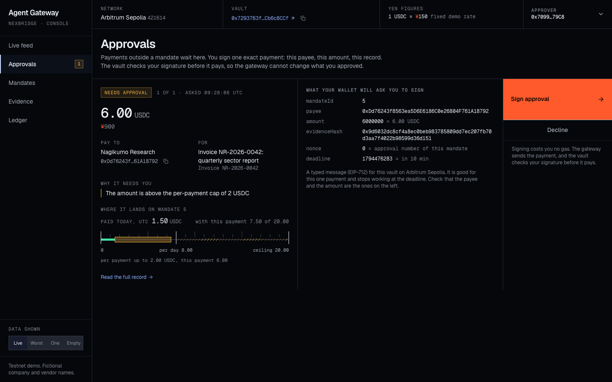

# Console

The web console for Agent Gateway. It shows what agents asked for, what the gateway decided and why, what
waits for a person, and what each mandate allows. The principal creates and revokes mandates here, and the
approver signs approvals here, each with their own wallet. React, wagmi and viem.

> Testnet demo. The console runs on your machine and talks to a gateway on your machine.



More screenshots, with what each one shows: [`docs/console`](../../docs/console/README.md).

## Screens

| Screen    | What it shows                                                                                                                           | What you can do                                               |
| --------- | --------------------------------------------------------------------------------------------------------------------------------------- | ------------------------------------------------------------- |
| Live feed | Every request an agent sent, newest first: outcome, amount, payee, reasons, and the payment's transaction.                              | Open the evidence, or the transaction on Arbiscan.            |
| Approvals | Payments that wait for a person, one at a time, with the exact message the wallet will show and where the payment lands on the mandate. | Sign the approval, or decline, with the approver's wallet.    |
| Mandates  | Each mandate read from the vault, drawn to scale: caps, today's spending, payees by name, and the text the principal approved.          | Create a mandate, or revoke one, with the principal's wallet. |
| Evidence  | One request's record: who asked, what for, every check, the evidence hash, what is onchain, and the record checked against the chain.   | Copy hashes, open transactions.                               |
| Ledger    | The gateway's running record, with its chain of hashes drawn and checked.                                                               | Open the evidence behind an entry.                            |

USDC amounts carry a yen figure at a fixed demo rate of ¥150 per USDC. It is not a market rate, and the top
strip says so.

## Run it

```bash
pnpm gateway           # the gateway, on http://127.0.0.1:8787
pnpm console           # the console, on http://127.0.0.1:5173
```

With the demo, so that you can watch it and sign the approval of step 4 yourself:

```bash
pnpm console
pnpm demo --console    # in a second terminal
```

`pnpm demo --console` serves the demo's own gateway where the console expects it, so stop `pnpm gateway`
first. Step 4 then waits until the approver signs or declines in the console, and the gateway keeps serving
after the last step until you press Ctrl+C. Without `--console` the approver's key signs in the terminal.

Settings are read from the shell, not from `.env`:

| Variable       | Meaning                                                                                    |
| -------------- | ------------------------------------------------------------------------------------------ |
| `GATEWAY_PORT` | Where the gateway listens. Set it for the console too if you changed it. Defaults to 8787. |
| `VITE_RPC_URL` | The RPC endpoint the browser reads the vault from. Defaults to the public one.             |

## Wallets

The console never holds a key. It asks a browser wallet:

- **The principal's wallet** sends a transaction to the vault to create or revoke a mandate. That costs gas.
- **The approver's wallet** signs a typed message (EIP-712) to approve one exact payment, or to decline it.
  That costs no gas: the gateway sends the payment, and the vault checks the signature before it pays.

The top strip says what the connected wallet is in this vault: principal, approver, or neither. The buttons
that need a role stay ruled out until the right wallet is connected, and say which wallet they need.

The wallet menu lists a browser wallet by its own name if the wallet announces itself (EIP-6963), as
current wallets do. "Browser wallet" is the entry for one that does not.

An approval alone moves nothing. Only the mandate's executor can submit it, it covers one payee, one amount
and one evidence record, and it stops working at its deadline.

**Use a plain key as the approver.** If the approver's address has contract code, which is the case for a
smart account and for a key with an EIP-7702 delegation, the vault asks that code about the signature
instead of checking the key. The gateway asks the same question first and tells you if the code did not
confirm the signature; nothing is sent in that case.

## What it reads, and from where

- **From the gateway, over HTTP:** decisions, approvals, evidence files, the ledger, the names in the vendor
  registry and the texts of mandates. The requests go through the development server, so the browser speaks
  to one origin only. The types of these answers are the gateway's own (`@agent-gateway/gateway`), imported
  as types only.
- **From the chain, directly:** the mandates. The limits and today's spending on the Mandates screen come
  from the vault, not from the gateway.

A new mandate's text is built in the browser, stored at the gateway under its own hash, and that hash goes
into the vault with the limits. Anyone holding the text can check it against the chain.

## Data shown

The switch at the bottom left chooses what the screens show. It is a tool for building the console: it
exists in the development build only, and a production build always shows the gateway and the chain.

- **Live:** the gateway and the chain.
- **Worst:** made-up data that strains the layout, taken from what the gateway and the vault accept: a
  thousand requests, the longest name and purpose, one-letter and non-Latin names, the largest amount
  (2^256 − 1), text that must not be run or formatted, every outcome, a page-long error, an expired signing
  window, a mandate with forty payees and no end date, a ledger whose chain is broken.
- **One:** exactly one of everything, to check words such as "1 payee" and "1 entry".
- **Empty:** the screens with nothing in them.

A banner says when the data is made up, and signing is switched off. `?data=worst`, `?data=one` and
`?data=empty` in the address do the same as the switch.

To use the console without the switch, build it and serve the build. One command from the repository's
root does both, and the built console listens on the same address:

```bash
pnpm console:built
```

[`docs/RECORDING.md`](../../docs/RECORDING.md) uses the built console for the recorded run.

## Rehearse on a local fork

To try the whole path without a browser wallet and without spending anything, run the demo against a local
fork of Arbitrum Sepolia and let the node sign:

```bash
anvil --fork-url https://sepolia-rollup.arbitrum.io/rpc --port 8546 --auto-impersonate
VITE_RPC_URL=http://127.0.0.1:8546 \
VITE_TEST_WALLETS=principal:<the vault's principal>,approver:<an account the node holds the key of> \
pnpm console
```

Each entry of `VITE_TEST_WALLETS` appears in the wallet menu as "Test wallet: principal" and so on. A test
wallet passes signing and sending on to the node. Test wallets exist only in a development build that reads
a node on this machine; any other build ignores the setting. The mandate's approver must be the account
named here, so run the demo on the fork with that account's key as `APPROVER_PRIVATE_KEY`.

One thing to know: on public testnets the well-known Anvil accounts carry EIP-7702 delegations, so the vault
treats them as smart accounts (see "Wallets" above). Clear the code on the fork first:
`cast rpc anvil_setCode <account> 0x --rpc-url http://127.0.0.1:8546`.

## Look

- **Tokens.** Colours, type and motion are the NexBridge brand tokens ("Ink & Signal"), copied into
  [`src/styles/tokens.css`](src/styles/tokens.css) with the source noted there. The console adds two colours
  the brand does not define: amber for "waiting" and a rose red for "refused".
- **The ruled sheet.** A screen is one sheet of cells divided by hairlines that run from edge to edge. There
  are no cards and no shadows.
- **The limit rail.** A mandate is drawn to scale: a ruler from zero to the hard ceiling, a post at the
  daily cap, today's spending filled in, the room for the next payment as a dashed bracket, and the stretch
  that needs an approval hatched. The Approvals screen uses the same rail to show where a waiting payment
  lands.
- **The signal colour.** Vermilion is kept for the one call to action on a screen and for the yen sign. An
  outcome is always written as a word; its colour only repeats it.
- **Motion.** Short and rare: a new row in the feed arrives over 200 ms, a press answers in 120 ms, a menu
  opens from its button in 200 ms and the dialog in 250 ms, all on the brand's curve. Only `transform` and
  `opacity` are animated. Hover styles apply only to a pointer that can hover. With "reduce motion" set in
  the system, fades stay and everything that moves, grows or pulses is taken out.
- **Keyboard.** Every action can be reached and done with the keyboard. The first stop skips to the
  content. The focus follows what was just done: to a screen's title when the screen changes, to the result
  after a signature, to the safe answer when a mandate is about to be revoked, and back to the button that
  opened a menu or the dialog.
- **Components.** Buttons, inputs, the dialog and the menus are [shadcn/ui](https://ui.shadcn.com)
  components (Radix underneath), installed into `src/components/ui` and restyled with the tokens. Fonts are
  Geist and Geist Mono, bundled with the app.

## Tests

```bash
pnpm --filter @agent-gateway/console test
```

61 tests, without a network and without a browser:

- **Against the gateway's real code.** The gateway runs in the test process on its in-memory stand-in for
  the chain, the console talks to it over HTTP, and a stand-in node plays the wallet. This pins down that
  the approval the console asks a wallet to sign is the one the gateway and the vault accept, that a decline
  is recorded and pays nothing, that a wallet which is not the approver or is on another network cannot
  sign, and that a new mandate goes to the vault with the limits from the form and the hash of the text
  that was stored.
- **Under strain.** Every screen on the worst-case data, on one of everything and on no data: nothing is
  cut that must be read in full, text is shown as it was sent, and counts are in the singular where they
  should be.
- **The focus.** Where it is after a screen change, a signature, a revocation, a menu and the dialog.
- **The parts.** Amounts and yen figures in whole-number arithmetic, times in UTC, the limit rail, the
  wallet menu, the address-bar routes, and that made-up data cannot be chosen in a production build.

Five things were checked in a real browser on a local fork, as described above:

- the whole path: steps 1 to 7 of the demo with the approval signed in the console, and a mandate created
  and revoked from the console;
- the same with the keyboard only: connecting a wallet, signing, the dialog and the two steps of revoking;
- every screen on the worst-case data at 1440 px, at 200% zoom, at 320 px and at 2560 px, without a sideways
  scroll, and what moves with and without "reduce motion";
- a production build served by `vite preview`: the feed, an evidence check, the mandates and the ledger,
  with no switch, no test wallet in the menu, and `?data=worst` changing nothing;
- the built console through the whole demo, with Claude as the agent and a pause before each step. A
  production build has no test wallets, so a stand-in for a browser wallet was put into the page: it
  announces itself as current wallets do and passes signing on to the fork's node. The approval was signed
  through it, and the wallet was asked for one typed message and no transaction. No real wallet extension
  has been used with the console yet.

## Limits

- It is served by Vite on localhost, as a development build or as a built one. There is no hosted version
  and no sign-in: whoever can open the page can read what the gateway serves.
- It shows the newest 200 requests and the newest 300 ledger entries, and reads the newest 12 mandates.
- It refreshes by asking again every few seconds. There is no push from the gateway.
- Names in a new mandate's text are the demo's fictional company and agent.
- A mandate's payees are all listed, however many there are, and the feed is not virtualized: it draws the
  200 rows it shows.
- Not tried with a screen reader, and only in Chrome.
- English only.
