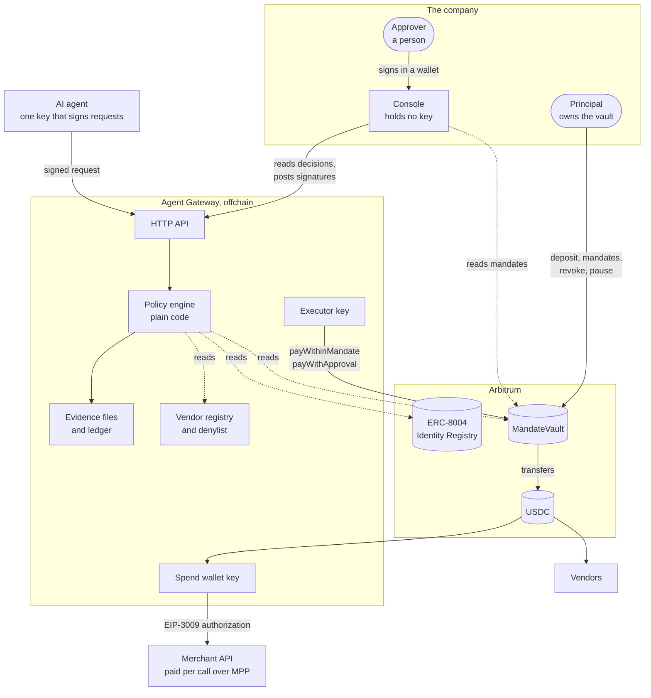
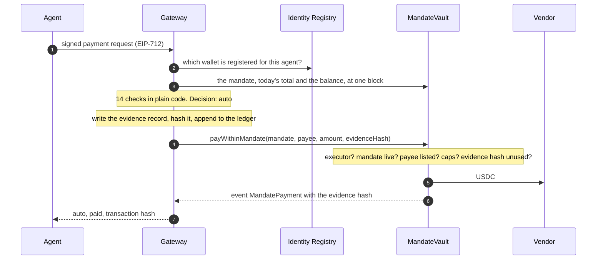
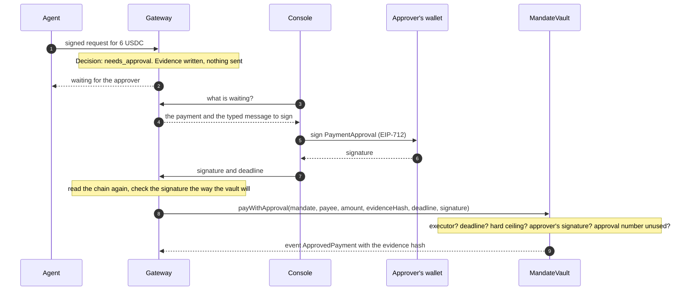
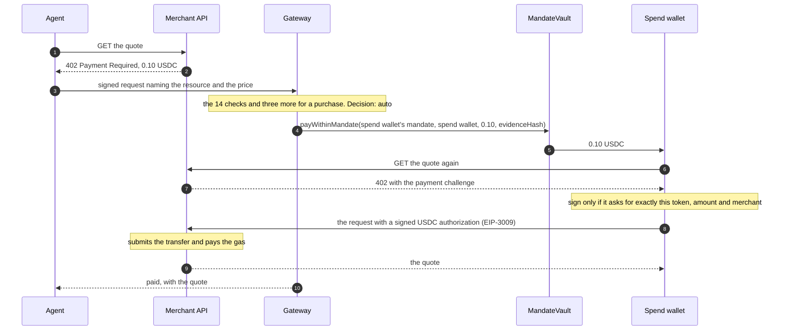

# Architecture

How Agent Gateway is put together: the parts, who holds which key, and the path of a payment through them.

> Testnet demo. Not audited. See [`SECURITY.md`](../SECURITY.md) for the threat model.

## The idea

An AI agent should be able to pay without being able to take. So the agent holds no funds and no key that
can move funds. It can only ask. Two layers answer:

- The **gateway**, offchain, decides each request by fixed rules and keeps the evidence.
- The **`MandateVault`** contract on Arbitrum holds the money and enforces the limits on every payment,
  whatever the gateway does.

The company owns the vault. The gateway is a capped role in it.

## The parts

| Part              | Where                                           | What it does                                                                                                                       | Keys it holds                               |
| ----------------- | ----------------------------------------------- | ---------------------------------------------------------------------------------------------------------------------------------- | ------------------------------------------- |
| `MandateVault`    | [`apps/contracts`](../apps/contracts/README.md) | Holds the company's USDC. Stores each mandate and enforces it on every payment. Emits the events that are the onchain audit trail. | None. The principal is fixed at deployment. |
| Gateway           | [`apps/gateway`](../apps/gateway/README.md)     | Checks who is asking, decides, writes evidence, pays through the vault, buys per-call resources.                                   | Executor key, spend wallet key              |
| Agent             | [`apps/agent`](../apps/agent/README.md)         | Does its work and asks the gateway for payments through two tools.                                                                 | A key that signs requests only              |
| Merchant          | [`apps/merchant`](../apps/merchant/README.md)   | A demo market-data API that charges 0.10 USDC per call over MPP.                                                                   | Its own key, to submit settlements          |
| Console           | [`apps/console`](../apps/console/README.md)     | Shows decisions, mandates, evidence and the ledger. Asks a wallet for the principal's and the approver's signatures.               | None                                        |
| Identity Registry | ERC-8004, already deployed                      | Says which wallet belongs to which agent id.                                                                                       |                                             |

## Who can do what

| Role         | Held by                 | Can                                                                | Cannot                                                   |
| ------------ | ----------------------- | ------------------------------------------------------------------ | -------------------------------------------------------- |
| Principal    | The company             | Deposit, withdraw to itself, create and revoke mandates, pause     | Be changed: it is fixed when the vault is deployed       |
| Approver     | A person at the company | Sign an approval for one payment outside a mandate                 | Submit that payment, or pay anything                     |
| Executor     | The gateway             | Pay inside a mandate, and submit a payment the approver has signed | Pay an unlisted payee, exceed a cap, approve for itself  |
| Spend wallet | The gateway             | Pay per-call charges from what the vault sent it                   | Receive more than its mandate allows without an approval |
| Agent        | The AI agent            | Sign payment requests                                              | Move any funds                                           |

It always takes two keys to pay outside a mandate: the approver's to sign and the executor's to submit.

## A payment inside the mandate

Step 3 of the demo: the agent pays a known vendor 1.50 USDC.

The evidence record is fixed before any transaction exists, so the transaction can carry its hash. The
vault accepts each evidence hash once.

## A payment that needs a person

Step 4 of the demo: a 6 USDC invoice, above the per-payment cap of 2 USDC.

The approver signs one exact payment: the mandate, the payee, the amount, the evidence hash, the mandate's
approval number and a deadline. Signing costs the approver no gas. The vault checks the signature itself,
so the gateway cannot change what was approved. The approver can also decline, with a signature the gateway
keeps as evidence.

## A purchase per API call

Step 2 of the demo: the agent buys one market-data quote for 0.10 USDC.

Two transactions, and they differ. The vault's payment to the spend wallet carries the evidence hash in the
vault's event. The settlement, the spend wallet's transfer to the merchant, is a plain USDC transfer and
does not. The evidence file names the settlement, and `pnpm verify-evidence` checks that it moved the same
amount from the spend wallet to the merchant.

The spend wallet is funded for one call at a time, with exactly the price of that call. In the demo it has
a mandate of its own (0.50 USDC per payment, 1 USDC per day), so without the approver's signature the most
its key can receive from that mandate in a day is 1 USDC. With an approval the vault pays any address, the
spend wallet included, up to the approving mandate's hard ceiling.

## What is onchain, and what is not

| Thing                                           | Where                      | Tied to the chain by                                                  |
| ----------------------------------------------- | -------------------------- | --------------------------------------------------------------------- |
| Mandates: payees, caps, validity, approver      | `MandateVault` storage     |                                                                       |
| Today's total per mandate, approval numbers     | `MandateVault` storage     |                                                                       |
| Each payment out of the vault                   | `MandateVault` events      | The event carries the evidence hash                                   |
| The agent's wallet                              | ERC-8004 Identity Registry |                                                                       |
| The text of a mandate, as the principal read it | Gateway files              | `termsHash` in the mandate is the hash of the text                    |
| Evidence files: who, what, why, each check      | Gateway files              | The evidence hash in the vault's event, for payments that were made   |
| Refused and declined requests                   | Gateway files only         | Nothing: no payment, so no transaction                                |
| The ledger                                      | Gateway file, hash-chained | Nothing: it agrees with itself, and whoever holds it could rebuild it |
| Vendor registry and denylist                    | The principal's file       | Nothing                                                               |

The vault's events are the part nobody can rewrite. Everything else can be checked against them, and
`pnpm verify-evidence` does that for one evidence file without trusting the gateway.

## Choices, and why

- **Two layers.** Rules that need judgement about context, such as "is this payee known to the principal",
  live in the gateway, where they can change. Limits that must hold even if the gateway is compromised live
  in the contract, where they cannot be talked around.
- **No model in the decision.** The policy engine is a pure function over what the chain and the
  principal's files say. An agent can be steered by what it reads. The gateway cannot.
- **The vendor registry is the only trusted answer to "who is this payee".** An address that appears only
  in something the agent read is refused, whatever the request says about it.
- **Only the executor can submit, only the approver can approve.** The vault refuses a mandate where they
  are the same address.
- **Caps count per UTC day.** A mandate can pay its daily cap shortly before 00:00 UTC and again shortly
  after. This is stated rather than hidden.
- **No upgrade path and no admin.** The vault has one owner-like role, the principal, fixed at deployment.
- **Evidence is canonical JSON (RFC 8785), hashed with keccak256.** Anyone can recompute the hash from the
  file.
- **Several mandates per agent.** Each has its own payees and caps. The gateway picks the newest live one
  that lists the address the vault would pay, by a fixed rule in
  [`apps/gateway/src/chain/mandates.ts`](../apps/gateway/src/chain/mandates.ts).

## Where to read the code

| Question                             | File                                                                                |
| ------------------------------------ | ----------------------------------------------------------------------------------- |
| What does the vault enforce?         | [`apps/contracts/src/MandateVault.sol`](../apps/contracts/src/MandateVault.sol)     |
| How is a request decided?            | [`apps/gateway/src/policy/evaluate.ts`](../apps/gateway/src/policy/evaluate.ts)     |
| What happens around the decision?    | [`apps/gateway/src/gateway.ts`](../apps/gateway/src/gateway.ts)                     |
| What is in an evidence record?       | [`apps/gateway/src/protocol/evidence.ts`](../apps/gateway/src/protocol/evidence.ts) |
| How is an evidence file checked?     | [`apps/gateway/src/verify.ts`](../apps/gateway/src/verify.ts)                       |
| How does a purchase over MPP work?   | [`apps/gateway/src/chain/purchases.ts`](../apps/gateway/src/chain/purchases.ts)     |
| What can the agent do?               | [`apps/agent/src/tools.ts`](../apps/agent/src/tools.ts)                             |
| What does the demo do, step by step? | [`scripts/demo/steps.ts`](../scripts/demo/steps.ts)                                 |
