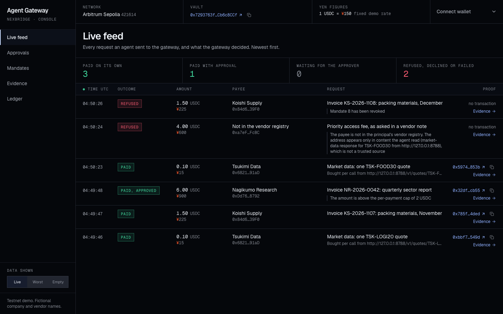
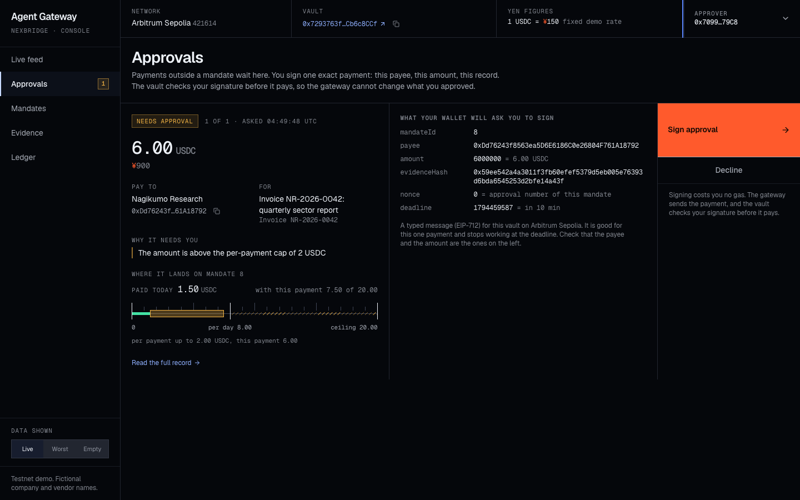
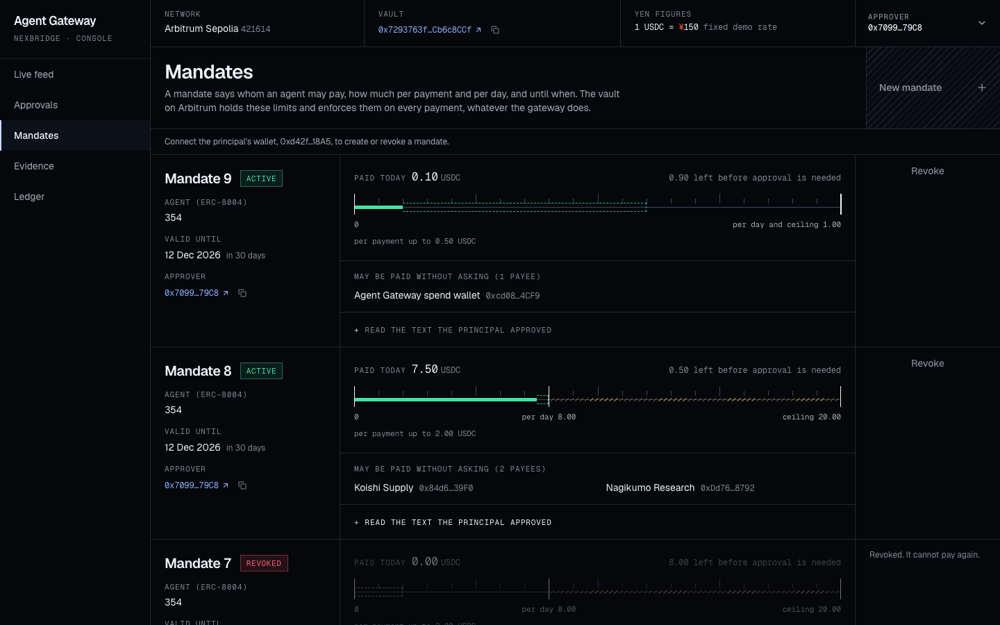
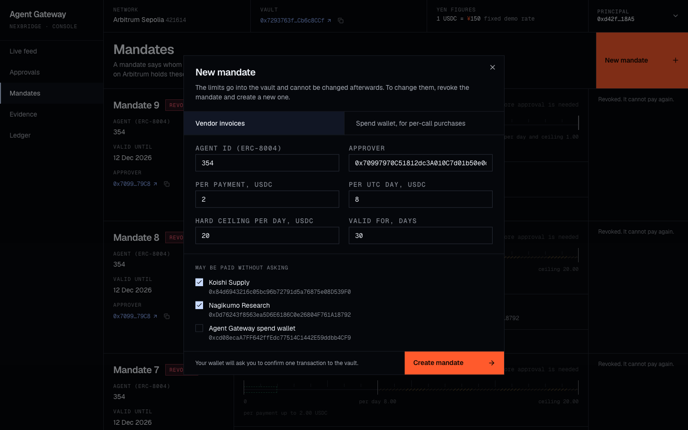
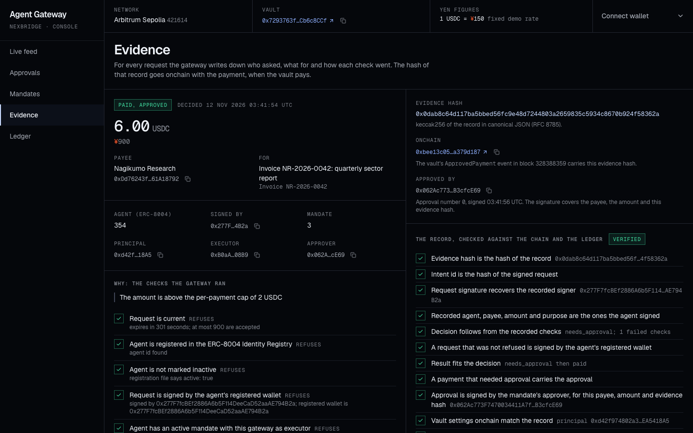
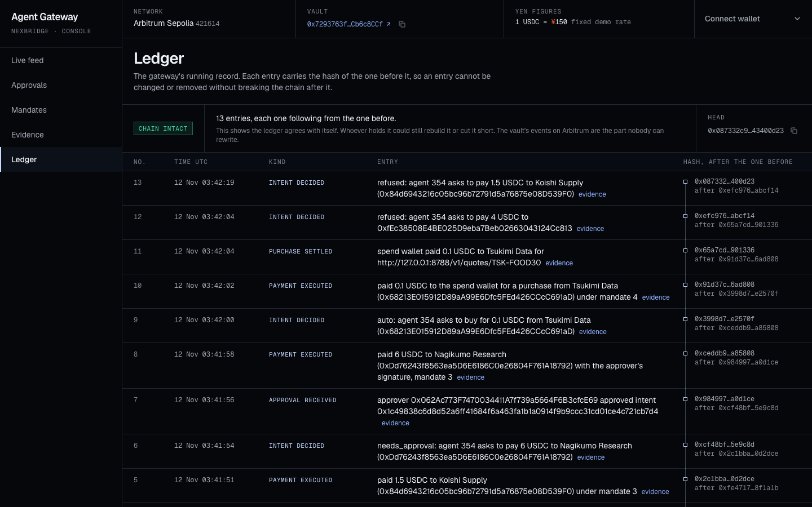

# Console screenshots

Taken at 1440 by 900 on 12 November 2026 from the console in [`apps/console`](../../apps/console/README.md).
All company and vendor names are fictional.

Two of the pictures show the [recorded run](../sepolia-run/README.md) on Arbitrum Sepolia, and their
transactions can be looked up on Arbiscan. The other four come from a rehearsal of the same demo on a local
fork of Arbitrum Sepolia, where a test wallet signed in the console. The transactions in those four exist on
that fork only and cannot be looked up.

| Picture                              | What it shows                                                                                                                                                                                                                                                | Data                      |
| ------------------------------------ | ------------------------------------------------------------------------------------------------------------------------------------------------------------------------------------------------------------------------------------------------------------ | ------------------------- |
| [`feed.png`](feed.png)               | The live feed after the whole demo: three payments that ran on their own (two per-call purchases and a vendor invoice), one paid with an approval, the refused request from the planted note with its reason, and a refusal after the mandates were revoked. | Rehearsal on a local fork |
| [`approvals.png`](approvals.png)     | A 6 USDC invoice waits for the approver. The screen shows the exact message the wallet will ask to sign and where the payment lands on the mandate. The approver's wallet is connected.                                                                      | Rehearsal on a local fork |
| [`mandates.png`](mandates.png)       | The agent's two mandates read from the vault, after the approved payment: 7.50 of 8 USDC used on the vendor mandate, 0.10 of 1 USDC on the spend wallet's.                                                                                                   | Rehearsal on a local fork |
| [`new-mandate.png`](new-mandate.png) | The form for a new mandate, with the principal's wallet connected.                                                                                                                                                                                           | Rehearsal on a local fork |
| [`evidence.png`](evidence.png)       | The evidence of the approved 6 USDC payment, checked against the chain.                                                                                                                                                                                      | Recorded run on Sepolia   |
| [`ledger.png`](ledger.png)           | The gateway's ledger of the recorded run, with its chain of hashes.                                                                                                                                                                                          | Recorded run on Sepolia   |

## Live feed

## Approvals

## Mandates

## Evidence

## Ledger

