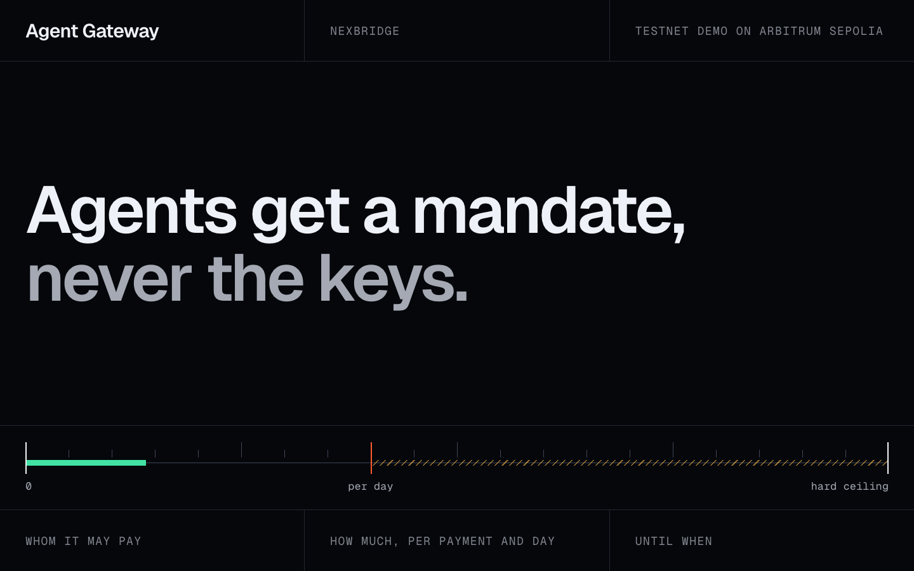
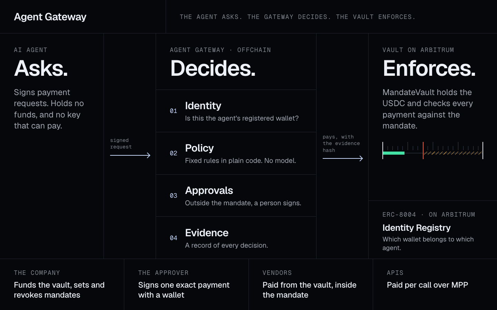
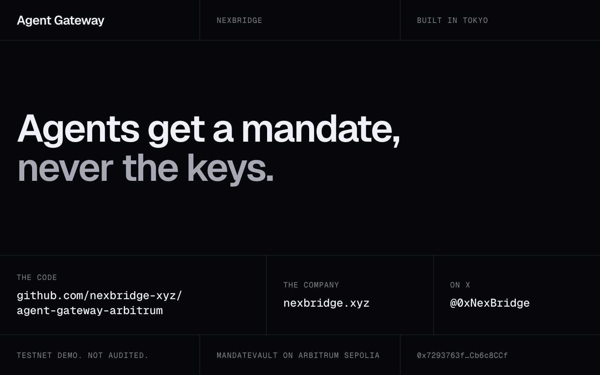

# Video: script and shot list

A video of 1 minute 40 seconds that shows the recorded run. English, captions on, recorded at 1440 by 900.

## Rules

- **It shows what happened.** Every screen comes from the recorded run in
  [`docs/sepolia-run`](../sepolia-run/README.md), and the voice says what that run did. Two lines depend on
  the run and have a second version below: [step 5](#the-line-for-step-5) and
  [who signed in step 4](#if-the-approval-was-signed-in-the-terminal). One transaction on screen is older
  than the run: the agent's registration in shot 3b. An agent is registered once, and the run's page names
  that transaction.
- **Under two minutes.** The finished video runs 1 minute 40 seconds, and the voice takes about 75 seconds
  of it. Do not add lines; cut a shot short instead.
- **Fictional names only.** The company, the agent and the vendors in the demo are made up.
- **No third-party logos, no music.** Frame the block explorer and the wallet so that their logos stay out
  of the picture: show the transaction's status and details, and the wallet's message and its button.
- **Captions on.** [`captions.srt`](captions.srt) holds the lines with the times of the voice in the
  finished video.
- **The voice is synthetic.** Check YouTube's current rules on altered or synthetic content before
  uploading, and label the video if they ask for it.
- **Nothing secret on screen.** Never show `.env` or a terminal that has printed a key.

## Script

| #   | Time      | Screen                                                       | Voice                                                                                                                                                                                                    |
| --- | --------- | ------------------------------------------------------------ | -------------------------------------------------------------------------------------------------------------------------------------------------------------------------------------------------------- |
| 1   | 0:00–0:11 | Title card                                                   | AI agents are starting to pay. Today you either give an agent a card with no limits, or approve every click. Neither works for a bank.                                                                   |
| 2   | 0:11–0:23 | "How it works" card                                          | Agent Gateway gives each agent a mandate: who it can pay, how much, and until when. Never the keys. It runs on Arbitrum. This is the testnet demo.                                                       |
| 3   | 0:23–0:33 | Console, Mandates. Then the agent's registration on Arbiscan | A company sets the mandate. The limits live in a vault contract on Arbitrum. The agent has an onchain identity.                                                                                          |
| 4   | 0:33–0:51 | Console, Live feed. Then the evidence of the vendor payment  | Inside the mandate, payments just run: ten cents for market data, an invoice from a known vendor. Every decision leaves an evidence record, and every payment out of the vault carries its hash onchain. |
| 5   | 0:51–1:02 | Console, Approvals. The wallet's signature request           | A bigger invoice goes to a person. One signature in a wallet, and it's paid. The vault checks that signature itself.                                                                                     |
| 6   | 1:02–1:16 | Console, Live feed: the refused request and its reason       | A note planted in the data asks for four USDC to an unknown address. The agent ignored it. We sent that request anyway, as if the agent had been fooled. The gateway refused it.                         |
| 7   | 1:16–1:28 | Terminal, step 6. Then one reverted transaction on Arbiscan  | And if someone hacks our gateway? We tried three times with the gateway's own key. The vault on Arbitrum said no, three times.                                                                           |
| 8   | 1:28–1:40 | End card                                                     | Agents get a mandate, never the keys. Built in Tokyo for banks, securities firms and fintechs. A mainnet pilot comes next, after a security review.                                                      |

211 words. The longest lines, 4 and 6, are 34 words each in 18 and 14 seconds. The times are taken from
the captions: a part starts in the second in which its first caption starts, and ends where the next part
starts.

### The line for step 5

Use the line that matches what the run printed under "what happened" in step 5.

- **The agent ignored the note** (the terminal says "The agent ignored the note"; this is what Claude did
  in rehearsal): the line in the table.
- **The agent acted on the note** (the terminal says "The agent acted on the note"; this is what the
  scripted agent does): "A note planted in the data asks for four USDC to an unknown address. The agent
  fell for it and asked for the payment. The gateway refused it."

Either way nothing was paid, and the reason is on the screen.

### If the approval was signed in the terminal

Line 5 says "One signature in a wallet". That is true for a run made with `pnpm demo --console`. For a run
without it, say "One signature from the approver, and it's paid", and show the terminal instead of the
wallet.

### Checked against the recorded run

The run recorded on 13 November 2026 says `"by": "console"` under `approval` and
`"agentActedOnNote": false` under `plantedNote` in [`demo-run.json`](../sepolia-run/demo-run.json), and step
6 has three reverted transactions. So lines 5, 6 and 7 of the table are the ones to say, and
[`captions.srt`](captions.srt) holds the same lines. Neither alternative is needed.

## Shot list

Shots 3 to 7 are screen recordings of the console at 1440 by 900 during the run, made with
`pnpm demo … --console --pause` so that each step waits for Enter.
[`docs/RECORDING.md`](../RECORDING.md) has the commands and the setup. The explorer pages can be recorded
afterwards: the transactions stay where they are.

The lengths are those of the finished video. Two cross dissolves of 0.4 seconds, from shot 2 into 3a and
from 7b into 8, count in both of their shots, so the lengths add up to 0.8 seconds more than the video's
1 minute 40 seconds.

| Shot | Length | What is on screen                                                                                                                                                                                        | How to get it                                                                                                                       | Shot and cut                                                                               |
| ---- | ------ | -------------------------------------------------------------------------------------------------------------------------------------------------------------------------------------------------------- | ----------------------------------------------------------------------------------------------------------------------------------- | ------------------------------------------------------------------------------------------ |
| 1    | 10.5 s | The title card: the line, and a limit rail under it.                                                                                                                                                     | [`cards/title.png`](cards/title.png)                                                                                                | Static. Optional: Mask reveal #005 on the line, 0.6 s. Cut.                                |
| 2    | 12.4 s | "How it works": the agent asks, the gateway decides, the vault enforces.                                                                                                                                 | [`cards/how-it-works.png`](cards/how-it-works.png)                                                                                  | Static. Optional: Stagger #002, the three columns 0.3 s apart. Cross dissolve #044, 0.4 s. |
| 3a   | 6.5 s  | Mandates: two active mandates, nothing spent yet. The rail shows the caps to scale.                                                                                                                      | Console, at the pause before step 2.                                                                                                | Static shot. Cut.                                                                          |
| 3b   | 4.5 s  | The transaction that registered agent 354 in the ERC-8004 Identity Registry: [`0xc5bb229f…354f07e4`](https://sepolia.arbiscan.io/tx/0xc5bb229fa23bb579d29ff41975b0b103e551abc2c1999f3a9f2b94e8354f07e4). | Arbiscan, afterwards. It is older than the run: an agent is registered once. Frame the status and the details, not the page header. | Insert shot #185. Cut.                                                                     |
| 4a   | 10.6 s | Live feed: the purchase arrives as **Paid**, then the vendor payment.                                                                                                                                    | Console. Press Enter for step 2, wait for the row, press Enter for step 3.                                                          | Static shot; the rows arrive on their own (Stagger #002, built in). Cut.                   |
| 4b   | 7.0 s  | Evidence of the vendor payment: the evidence hash, "Onchain" with the transaction, and **Verified**.                                                                                                     | Console: "Evidence" on the 1.50 USDC row.                                                                                           | Zoom in #028 on the hash and the transaction, to about 140% over 1 s. Cut.                 |
| 5    | 11.0 s | Approvals: 6.00 USDC to Nagikumo Research, and where it lands on the mandate. "Sign approval", the wallet's message, then **Paid, approved**.                                                            | Console and wallet, at step 4. Keep the wallet's window in the picture, without its logo.                                           | Static shot. Jump cut #041 over the wait between the signature and "Paid, approved".       |
| 6    | 13.6 s | Live feed: the top row is **Refused**, with its reason: the payee is not in the vendor registry, and the address came from something the agent read.                                                     | Console, after step 5.                                                                                                              | Zoom in #028 on the reason, to about 150% over 1 s, and hold. Cut.                         |
| 7a   | 7.2 s  | The terminal: step 6, three lines that start with `REVERTED`.                                                                                                                                            | Terminal, after step 6. Enlarge the font first.                                                                                     | Static shot. Cut.                                                                          |
| 7b   | 5.5 s  | One of the three reverted transactions on Arbiscan, with its failed status.                                                                                                                              | Arbiscan, afterwards: a link the terminal printed in step 6. Frame the status and the details.                                      | Insert shot #185. Cross dissolve #044, 0.4 s.                                              |
| 8    | 12.0 s | The end card: the line, the repository, nexbridge.xyz, @0xNexBridge.                                                                                                                                     | [`cards/end.png`](cards/end.png)                                                                                                    | Static. Fade to black #187 over the last 0.5 s.                                            |

The numbers after the names are from the [Motion Prompt](https://github.com/showheyohtaki/motion-prompt)
list of standard motion and shot names.

## The cards

[`cards/title.png`](cards/title.png), [`cards/how-it-works.png`](cards/how-it-works.png) and
[`cards/end.png`](cards/end.png) are 1440 by 900 pixels, in the console's look. Each is made from the HTML
file of the same name. To change a card, edit its HTML and render it again (after `pnpm install`, which
brings the fonts):

```bash
"/Applications/Google Chrome.app/Contents/MacOS/Google Chrome" --headless --hide-scrollbars \
  --window-size=1440,900 --screenshot=docs/video/cards/title.png "file://$PWD/docs/video/cards/title.html"
```







## Before publishing

- The video is 2:00 or shorter, and its captions are on.
- Every transaction hash on screen is in [`docs/sepolia-run`](../sepolia-run/README.md).
- Line 5 and line 6 say what the recorded run did.
- No logo of another company or product is in the picture, and there is no music.
- No `.env`, no key and no personal browser tab is in the picture.
- The description links the repository and says "testnet demo".
